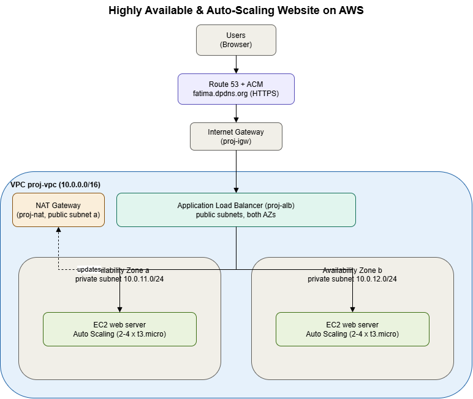

# Highly Available & Auto-Scaling Website on AWS

## What I built
A website that stays online when a server or an Availability Zone fails,
and adds servers automatically when traffic grows. Built on AWS across
two Availability Zones with a custom VPC, load balancing, auto scaling,
a custom domain and HTTPS.

**Live demo:** https://www.fatima.dpdns.org

## AWS services
VPC (2 AZs, public + private subnets), Internet Gateway, NAT Gateway,
Application Load Balancer, Target Group, Launch Template,
Auto Scaling Group (2-4 x t3.micro), Route 53, ACM (HTTPS).

## Architecture
- **Custom VPC** `10.0.0.0/16` with a public and a private subnet in each of 2 Availability Zones.
- **Internet Gateway** for public subnets; **NAT Gateway** so private servers can download updates.
- **Application Load Balancer** in the public subnets, spreading traffic across healthy servers in both AZs.
- **Auto Scaling Group** running the web servers in the private subnets (2 to 4 instances).
- **Route 53 + ACM** for the custom domain with free HTTPS.

## How it works
1. Users open https://www.fatima.dpdns.org (Route 53 -> ALB).
2. The ALB sends each request to a healthy server in AZ a or AZ b.
3. Servers run in private subnets; only the ALB can reach them (locked down with security groups).
4. Auto Scaling adds servers automatically when request count per server crosses the target.

## Tests
- **High availability:** terminated a running server — Auto Scaling replaced it automatically and the site stayed online.
- **Scalability:** sent traffic from AWS CloudShell — the group scaled out beyond the base 2 instances, then scaled back in after the load stopped.

## Demo video
[Watch the demo](your-video-link)

## What I learned
- How a VPC fits together: public vs private subnets, route tables, Internet Gateway vs NAT Gateway.
- Why web servers sit in private subnets and only the load balancer is public — and how security groups enforce that.
- How Auto Scaling + a launch template give self-healing and request-based scaling without managing servers by hand.

## Cost & clean-up
Built and deleted on the same day to keep costs low; total cost about $1-3.

---
Built as part of the Edversity Cloud Engineering Program.# -aws-highly-available-website
